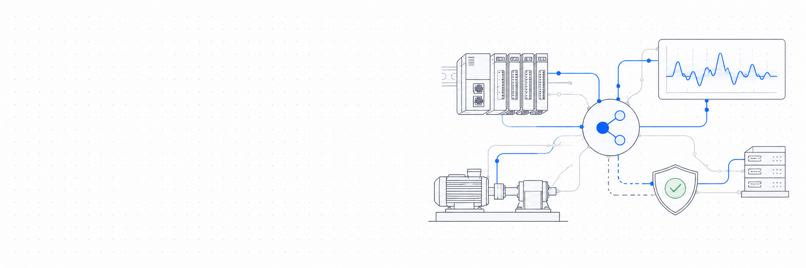
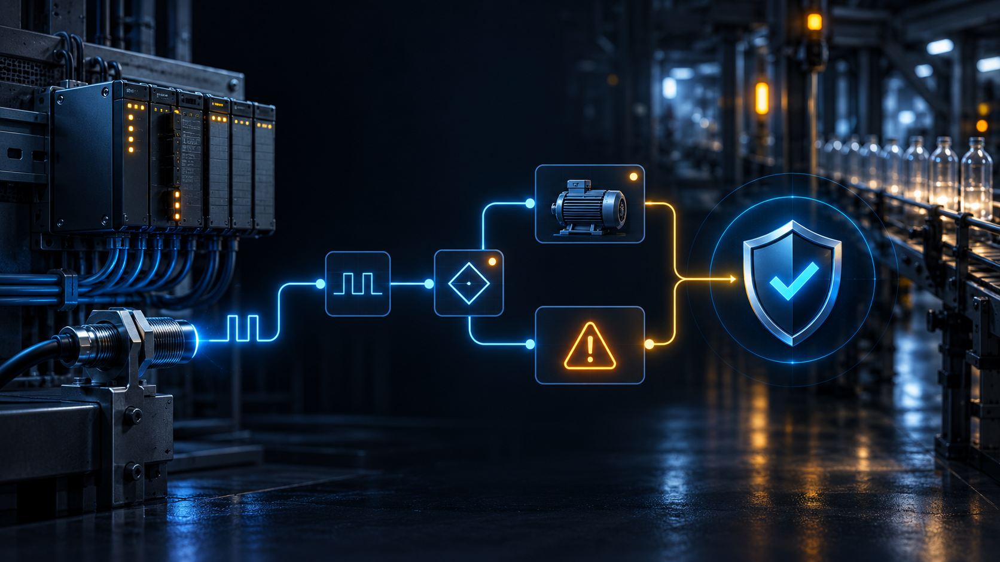

<picture>
  <source media="(prefers-color-scheme: dark)" srcset="assets/sens-profile-banner-dark.png" />
  
</picture>

# Привет! Я Матвей 👋

**Robotics · Embedded · Industrial Automation · Rust · Edge AI**

Я разработчик из Беларуси и работаю на стыке **робототехники**, **встраиваемых систем** и **промышленной автоматизации**. Сейчас развиваюсь в **Machine Learning & AI**, чтобы переносить интеллектуальные алгоритмы прямо на аппаратный уровень (Edge AI).

## 🏭 Сейчас работаю над

### SENS Nexor · команда SENS

**Nexor** — диагностическая прослойка для ПЛК. Она пассивно, только на чтение, собирает телеметрию с производственной линии и связывает события с логикой ПЛК, чтобы быстрее находить причины остановок.

Я отвечаю за **поток данных**: надёжную доставку телеметрии с edge-бокса на сервер. Это локальный буфер, повторы при обрывах связи и гарантия *ноль потерь и ноль дублей*, даже если сервер или процесс падают.

## 📈 Другие проекты

<blockquote>
  <h3>🐾 Mobile Walking Robot-Assistant</h3>
  
Групповой проект четвероногого робота-помощника для мониторинга потенциально опасных объектов на производстве. Отвечаю за архитектуру в ROS 2, моделирование в urdf.xacro, управление через ros2_control и симуляцию в Gazebo.

</blockquote>

<blockquote>
  <h3>🎛 Industrial AI Controller</h3>
  
Умный промышленный контроллер. Система в реальном времени собирает логи по протоколам EtherCAT/Modbus и использует локальные нейросети, оптимизированные через <b>ONNX Runtime</b>, для предиктивной аналитики, интерактивной диагностики и работы с LLM.

</blockquote>

## 🛠 Технологии

**🤖 Robotics & Hardware**

**🧠 Machine Learning & Data Science** *(в активном изучении 🚀)*

**💻 Infrastructure & OS**

## 📫 Контакты

* **Telegram:** [@k0ttel](https://t.me/k0ttel)
* **LinkedIn:** [Matsvei Lysenko](https://www.linkedin.com/in/matsvei-lysenko-727436324)
